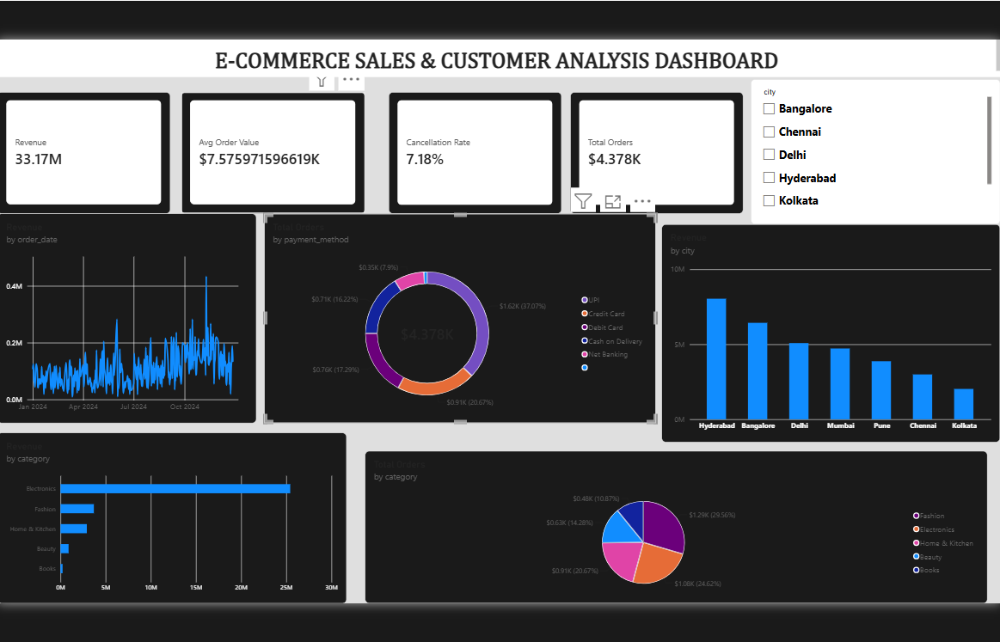

# E-Commerce Sales & Customer Analysis

Analysis of a sample e-commerce dataset (5,000 orders, 1,000 customers, 40 products) to find what drives revenue, which customers matter most, and where the business loses sales.

**Note:** The dataset is a sample created for practice. It is not real company data.

## Tools Used
Python (Pandas, Matplotlib), MySQL, Power BI, Excel

## Project Steps
1. Cleaned the data: removed 25 duplicate orders and filled 40 missing payment methods.
2. Joined the customers, products and orders tables.
3. Calculated revenue from delivered orders only.
4. Wrote 9 MySQL queries (joins, GROUP BY, subqueries, window functions).
5. Built a Power BI dashboard with KPI cards, charts and slicers.

## Key Findings
- Total revenue: Rs 3.32 crore from 4,378 delivered orders
- Average order value: Rs 7,576
- Electronics gave about 77% of revenue
- The top 20% of customers gave about 71% of revenue
- October to December gave about 37% of yearly revenue
- Cancellation rate: 7.2%, return rate: 5.3%
- About 77% of customers ordered more than once

## Recommendations
- Plan stock and ad budget for the festive season (Oct-Dec)
- Create a loyalty programme for the top 20% of customers
- Investigate the reasons for cancellations
- Promote Fashion and Home & Kitchen to reduce dependence on Electronics

## Files
- `ecommerce_analysis.py` - data cleaning, KPIs and charts
- `ecommerce_queries.sql` - MySQL queries
- `Ecommerce_Dashboard.pbix` - Power BI dashboard
- `dashboard.png` - dashboard screenshot
- `customers.csv`, `products.csv`, `orders.csv` - dataset

## Dashboard

